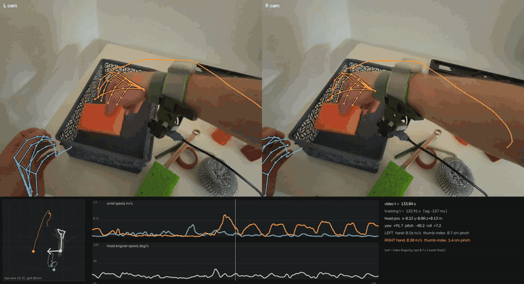

# Трекинг рук PICO 4 Ultra поверх видео

Наложение записанного шлемом трекинга рук на стереовидео с его камер. Данные: видео `CameraRecord_20260505_165740.mp4`, журнал трекинга `trackingData_20260505_165740.txt` (репозиторий [XRoboToolkit](https://github.com/XR-Robotics)).



В обеих половинах кадра нарисованы скелеты рук по 26 суставам и след кончика указательного пальца за 0,7 с. Внизу: карта сверху (голова и запястья), скорости запястий и головы в окне ±6 с, параметры текущего кадра.

Полное видео (4 мин 03 с, 2160×1170): [смотреть на Google Диске](https://drive.google.com/file/d/1wvgJ9cicv0Vd9aSI5cww-2aJ9TlUUmfA/view?usp=sharing)

## Запуск

Проверено на Python 3.15 (Windows). Исходные файлы положить в папку `sources/` с оригинальными именами. Все команды выполняются из корня репозитория.

```sh
python -m venv .venv
.venv\Scripts\activate            # Linux/macOS: source .venv/bin/activate
pip install -r requirements.txt

python run.py                     # всё видео -> output/overlay.mp4, ~13 мин
python run.py --quick             # фрагмент 1:58–2:22 -> output/overlay_quick.mp4, ~4 мин
```

### Составные части

`run.py` по очереди запускает четыре шага. Каждый сохраняет результат в `data/`, поэтому любой шаг можно перезапустить отдельно, не пересчитывая предыдущие.

| Шаг | Скрипт | Что делает | Время |
|---|---|---|---|
| 1 | `src/parse_tracking.py` | разбирает журнал трекинга в numpy-массивы → `data/tracking.npz` | ~15 с |
| 2 | `src/estimate_sync.py` | находит задержку видео относительно трекинга → `data/sync.npz` | ~1 мин |
| 3 | `src/calibrate_skin.py` | подбирает параметры камеры и уточняет задержку → `data/calib_skin.npz` | ~2 мин |
| 4 | `src/render_overlay.py` | рисует видео с наложением → `output/` | ~1–10 мин |

Вспомогательные файлы:

- `src/common.py` — общие константы и функции: суставы, оси, модель камеры, интерполяция позы.
- `src/estimate_focal.py` — независимая проверка фокуса по поворотам головы. Для видео не нужна, запускается отдельно.

Рендер можно запускать с параметрами:

- **Фрагмент:** `python src/render_overlay.py output/clip.mp4 118 24 0.5` — с 118-й секунды, длиной 24 с, в половинном размере.
- **Один кадр:** `python src/render_overlay.py still 4000 output/frame.jpg` — кадр № 4000.

## Подход

Шлем записывает положение головы и 26 суставов каждой руки в метрах, 90 раз в секунду. Камера видит те же руки в пикселях, 30 кадров в секунду. Для наложения каждый сустав проецируется в кадр моделью pinhole-камеры, отдельно для левой и правой камеры. Чтобы проекция совпала с картинкой, понадобились два шага:

1. **Синхронизация.** У кадров видео нет меток времени. Задержка найдена по корреляции двух сигналов: глобального сдвига кадра (фазовая корреляция соседних кадров) и сдвига, предсказанного по угловой скорости головы.
2. **Калибровка камеры.** Параметры из файла дают заметно смещённое наложение. Фокус, поворот и смещение камеры относительно головы, а также сдвиг по времени подобраны оптимизацией. Критерий: проекции суставов в 300 кадрах должны попадать на пиксели кожи. Независимая оценка фокуса по гомографиям поворота (около 61 тыс. ORB-точек) дала тот же результат.

## Наблюдения

- **Трекинг стабильный.** Частота 90 Гц, длительность совпадает с видео (242,5 с и 242,65 с). Левая рука отслеживается в 100% строк, правая — в 99,4%. Контроллеров нет, ввод всё время руками.
- **Видео отстаёт от трекинга на ~137 мс.** Без этой поправки при поворотах головы скелет «слетает» с руки.
- **Фактический фокус ~780 px на глаз** вместо 687 px по данным SDK. Камера смотрит туда же, куда голова.
- **Сценарий.** Человек за столом, голова опущена на ~53° и почти неподвижна (смещение в пределах 21×9×26 см). Правая рука перекладывает предметы в корзину, левая в основном держит.

## Сложности

- **Десятичная запятая.** Числа в позах записаны с запятой, и ею же разделены значения. Иногда попадаются целые без дробной части, поэтому разбор идёт с учётом ожидаемого числа значений.
- **Противоречивая документация по осям.** В README рукам приписана «левосторонняя» система. По данным (руки перед лицом и ниже глаз) подтвердилась правосторонняя система: X вправо, Y вверх, взгляд вдоль −Z.
- **Неточные intrinsics.** Параметры посчитаны SDK для «кадра» 2160×810, хотя это два кадра по 1080×810, поэтому горизонтальные значения нужно делить пополам. Даже после этого фокус занижен примерно на 12%.
- **Неоднозначность калибровки по поворотам.** Одно только движение фона не различает наклон камеры и смещение центра кадра. Понадобилась привязка к самим рукам: подгонка по маске кожи.
- **Скелет тела (`Body`) не наложен.** Это оценка без внешних трекеров, и с видео она расходится.

## Допущения

- Видео и трекинг стартуют одновременно, задержка камеры постоянная.
- Камеры жёстко закреплены относительно точки позы головы. База стерео (64 мм) взята из `cameraExtrinsics`.
- Точность наложения — 1–4 см на руки. Основные источники ошибки: сам трекинг рук (пальцы, закрытые предметом) и неточность фокуса.

## Использование ИИ

Ни с чем похожим я никогда не работал. Постоянно упирался в тупик, поэтому приходилось обращаться за помощью к ИИ-агенту, в т. ч. для написания кода (последние 4 года пишу на JS/TS). Использовалась модель Claude Opus 5.5 (thinking mode + high effort).
